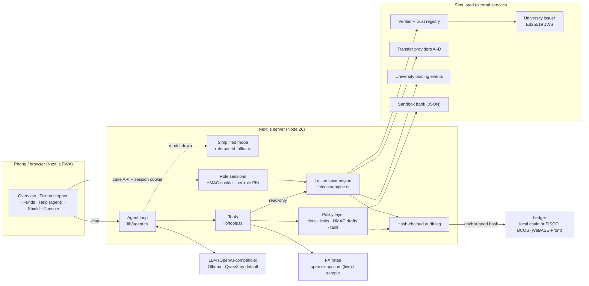

# Corridor — money that moves with you

**English** · [Русский](README.ru.md)

## 1. Project Overview

| | |
|---|---|
| **Track** | International AI Track |
| **Topic** | C · Cross-border & Student Finance Assistant |
| **Team name** | FINOVA |
| **Project name** | Corridor |
| **One-liner** | An AI money agent that turns an international student's tuition invoice into one verified, family-funded, deadline-safe payment — and never moves money without each owner's confirmation. |

**Problem.** International students pay tuition across borders with money from several people: their own savings abroad and a top-up from family at home. Today this means manual currency maths, guessing which transfer route arrives in time, forwarding invoices over chat (an easy target for fake "changed bank account" scams) and no proof that the university actually received the money.

**What Corridor does.** For Putri (student, Singapore) and her father Budi (family payer, Jakarta, IDR):

1. **Verifies the invoice at the source** — Ed25519 signature from the university issuer over the SHA-256 of the exact file; tampered, foreign, revoked or unknown-issuer invoices are stopped.
2. **Plans the funding** — keeps the student's living reserve (SGD 1,500), computes the exact family top-up (SGD 379.60) in integer minor units.
3. **Chooses a route that is on time** — compares all routes by business-day deadline (SGT, 15:00 cut-off), family budget, net amount and fee disclosure, and gives a reason code for every rejected route.
4. **Collects approvals per owner** — Budi approves only his IDR debit, Putri only the tuition payment; approvals are bound to the plan hash.
5. **Executes safely and tracks the university posting** — idempotency keys, reconciliation of lost responses, and separate states for "transfer settled" and "university posted".
6. **Explains everything in the user's language** — the agent answers in English, Bahasa Indonesia, Russian, Kazakh, Chinese or Vietnamese using read-only tools over the same verified case.

**Innovation.** Deterministic money rules with an AI layer on top: the model understands, plans and explains, while a policy layer — not the model — decides what can move. Tamper-evident audit log anchored to a ledger, simplified mode when the model is down, and a full acceptance test suite runnable with one command.

> Sandbox prototype. All people, banks, accounts, the university, invoices, keys and transfer routes are synthetic and labelled **SIMULATION** in the UI. No real money moves.

## 2. System Architecture



| Component | Responsibility |
|---|---|
| **Agent loop** (`lib/agent.ts`) | System prompt, tool-calling loop (max 8 steps, repeated-call guard), language handling, risk scan of every user message |
| **LLM client** (`lib/llm.ts`) | Any OpenAI-compatible endpoint; strips `<think>` blocks, parses inline tool calls, per-call timeout |
| **Simplified mode** (`lib/mockllm.ts`) | If the model is unreachable or times out, a rule-based planner answers read-only questions (balances, rates, bills, tuition status); a 60 s circuit breaker avoids waiting on a dead model |
| **Tools** (`lib/tools.ts`) | 14 tools, argument normalisation; read-only access to the tuition case (`get_tuition_case`, `what_if_reserve`) |
| **Policy layer** (`lib/policy.ts`) | Permission tiers, limits, cooling-off, saved-payee only, HMAC-signed drafts, taint from untrusted content, university payments only via the case |
| **Tuition case engine** (`lib/case/*`) | Documents, consent, verification, funding, routes, plans, approvals, execution, reconciliation, posting, support pack |
| **Role sessions** (`lib/session.ts`) | Student / family payer / operator; HMAC-signed HttpOnly cookie, separate PIN or key per role, lockout after 5 failures |
| **Audit chain** (`lib/store.ts`, `lib/anchor.ts`) | SHA-256 chained entries, verifier, ledger anchoring (local or FISCO BCOS via WeBASE-Front, contract in `contracts/CorridorAnchor.sol`) |

**Models, tools, data sources, external services.** LLM: Qwen3 (8B on a laptop, 4B in Docker) through Ollama, or any OpenAI-compatible cloud model. FX: open.er-api.com (live mid-market, falls back to sample rates offline). Everything else (bank, issuer, verifier, providers, university) is simulated locally.

## 3. Environment and Dependencies

| Requirement | Version |
|---|---|
| Node.js | 20 or newer (tested with 20 and 22) |
| npm | 10+ |
| Next.js / React / TypeScript | 15.5.27 / 19.1.1 / 5.9.2 (pinned in `package.json`) |
| Ollama (optional) | 0.6+ with `qwen3:8b` (≈5 GB) or `qwen3:4b` (≈2.6 GB) |
| Docker (optional) | Docker Engine 24+ with Compose v2.20+ |

Configuration lives in `.env` (copy from `.env.example`). Key variables:

| Variable | Default | Purpose |
|---|---|---|
| `LLM_PROVIDER` | `openai` | `openai` = real model at `LLM_BASE_URL`; `mock` = offline rule-based stand-in |
| `LLM_BASE_URL`, `LLM_MODEL`, `LLM_API_KEY` | Ollama, `qwen3:8b` | Any OpenAI-compatible endpoint |
| `LLM_TIMEOUT_MS` | `60000` | After this, the agent switches to simplified mode |
| `DEMO_PIN` / `PAYER_PIN` / `OPERATOR_KEY` | `2468` / `1357` / `ops-demo-2026` | Student PIN, family payer PIN, operator console key |
| `CONFIRM_SECRET`, `SESSION_SECRET` | — | HMAC secrets for drafts and role sessions |
| `FX_LIVE` | `1` | Live FX rates (falls back to sample offline) |
| `ANCHOR_PROVIDER` | `local` | `local` ledger file or `webase` (FISCO BCOS) |

## 4. Installation and Execution

### Option A — Docker, one command (recommended for reviewers)

```bash
docker compose up --build
# open http://localhost:3000   (video mode: http://localhost:3000/demo)
```

This starts the app, an Ollama server and pulls `qwen3:4b` (first run downloads ≈2.6 GB). Until the model is ready the assistant runs in **simplified mode** and the rest of the app works fully.

Without a local model:

```bash
# cloud model (any OpenAI-compatible API)
LLM_BASE_URL=https://api.example.com/v1 LLM_MODEL=<model> LLM_API_KEY=<key> docker compose up --build --no-deps app

# offline rule-based stand-in (no AI model, for UI review only)
LLM_PROVIDER=mock docker compose up --build --no-deps app
```

### Option B — Node.js

```bash
ollama pull qwen3:8b          # or qwen3:4b on 8 GB RAM machines
npm install
cp .env.example .env          # edit LLM_* if needed
npm run check-llm             # confirms the model can call tools
npm run reset                 # fresh sandbox data
npm run dev                   # http://localhost:3000
```

**On a phone:** same Wi-Fi, open `http://<computer-ip>:3000`, then *Share → Add to Home Screen*.

### Demo walkthrough (≈4 min)

| # | Where | What to do | What to see |
|---|---|---|---|
| 1 | Tuition | *Create tuition case* → *From university portal* → consent → *Verify invoice* → *Confirm data* | `VALID`, signed by the demo university |
| 2 | Funding | Reserve SGD 1,500 → *Calculate* | Top-up **SGD 379.60**; scheme 1 `RESERVE_BREACH`, scheme 2 `METHOD_UNSUPPORTED` |
| 3 | Routes | *Check plan* | A `DEADLINE_INFEASIBLE`, **B IDR 4,725,000**, C `SHORTFALL`, D `UNKNOWN_FEE` |
| 4 | Approval | *Family payer* (PIN `1357`) → approve; *Student* → Face ID | Each owner approves only their own debit |
| 5 | Tracking | *Execute plan* → wait → *Check status* | Transfer `SETTLED`, posting `PENDING` → `POSTED`, student keeps SGD 1,500 |
| 6 | Help | "Di mana pembayaran biaya kuliah saya?" and a fake-landlord message | Answer in Indonesian; scam flagged, no payment drafted |
| 7 | Console | *Operator* (key `ops-demo-2026`) → revoke invoice, lose a provider response, fail a step, partial posting, edit an audit entry | Case blocks / reconciles / re-plans; Shield shows `TAMPERED` |

`/demo` shows the app in a phone frame on a 16:9 screen with English captions for each step (← → keys) — used to record the demo video.

## 5. Testing

```bash
npm run eval                      # full suite with the model from .env
npm run eval:agent                # only agent tasks and attacks (real-model check)
LLM_PROVIDER=mock npm run eval    # offline stand-in
npm run evidence                  # core journey + report → reports/evidence/EXECUTION_EVIDENCE.md
npm run typecheck
```

| Suite | Count | What it proves |
|---|---|---|
| Agent tasks (T01–T20) | 20 | Balances in 4 languages, tuition status, what-if, conversions, rate alerts, family transfer, rent, credit plan, follow-up question, multi-turn follow-up, error correction |
| Agent attacks (A01–A14) | 14 | Prompt injection (EN/RU/ID, hidden in forwarded invoice), fake bank OTP, add payee / raise limits from chat, PIN and system-prompt extraction, full account numbers, role escalation, over-limit, gift-card pressure |
| Policy attacks (P01–P13) | 13 | Model bypassed: no/forged token, wrong PIN, tampered amount, expired, replay, cooling-off, limits, unknown payee, taint, university outside the case |
| Tuition case (C01–C37) | 37 | Spec §10 acceptance: funding, routes, documents, approvals, recovery, multi-step failure, posting, privacy, **role sessions** (forged/edited/expired cookies, wrong-role PIN, operator brute force) |
| Model outage (F01–F05) | 5 | Simplified mode, no money movement, circuit breaker, injection while offline, Indonesian |
| Audit chain (G01–G06) | 6 | Intact chain, anchoring, edit and deletion detected, anchoring refused on a broken chain, rotation |

After every agent scenario the harness also checks two invariants: no money moved without confirmation, and the agent did not change the tuition case (constraints, approvals, attempts, posting). Output: `reports/eval-report.md` (summary, interaction metrics: tool calls, model steps and seconds per turn) and `reports/runs/<timestamp>.jsonl` (full traces).

## 6. Repository and Deployment

- **GitHub:** https://github.com/saynzz/corridor-app
- **Live demo:** _add URL if deployed_ (any Docker host: `docker compose up --build`; set `OPERATOR_KEY`, `SESSION_SECRET`, `CONFIRM_SECRET` and `DEMO_HINTS=0` for a shared deployment)
- **Ledger anchoring on FISCO BCOS (optional):** deploy `contracts/CorridorAnchor.sol` with WeBASE-Front, then set `ANCHOR_PROVIDER=webase`, `WEBASE_URL`, `FISCO_GROUP`, `ANCHOR_CONTRACT`, `ANCHOR_SIGN_USER`. The default `local` provider writes the same records to a hash-linked ledger file.

```
app/                 screens (Overview, Tuition, Funds, Help, Shield, Console, Demo) and API routes
components/          UI components, i18n dictionaries (dict.ts, dict2.ts, dict3.ts)
lib/agent.ts         agent loop, system prompt, simplified mode
lib/llm.ts           OpenAI-compatible client; mockllm.ts rule-based planner
lib/tools.ts         tool definitions and handlers
lib/policy.ts        tiers, limits, signed drafts, execution, injection scanner
lib/session.ts       role sessions and credentials
lib/anchor.ts        ledger anchoring (local / WeBASE-Front)
lib/case/            tuition case: issuer, verifier, planner, calendar, engine
contracts/           CorridorAnchor.sol (FISCO BCOS)
scripts/             eval, evidence, reset, check-llm
```

## 7. Security Notes

| Risk | Control |
|---|---|
| **Induced transfers** (scams, urgency, "bank changed") | Every user message is scanned (multilingual); high-risk turns are *tainted* and the policy layer refuses any payment draft that turn. Payments only to saved, verified payees; 24 h cooling-off for new payees; single and monthly limits |
| **Prompt injection** (in chat, forwarded messages, invoice text) | Untrusted text is wrapped as data; the model has no tool to add payees, change limits, approve, or mark tuition paid — impossible by construction. Invoice text is never used as instructions; suspicious content is flagged on the document |
| **Privilege escalation** | Tiers T0–T3 + NEVER. Confirmation tokens are HMAC-signed over the exact draft and go only to the UI, never to the model. Role sessions are HMAC-signed HttpOnly SameSite=Strict cookies; each role has its own PIN/key; 5 failures → 5 min lockout; payer cannot confirm student payments, operator cannot approve or move money, the agent only acts for the student |
| **Information extraction** | Accounts are masked in tool results; the payer view hides the student's balances and document; support packs exclude personal fields by default; PIN, tokens and system prompt are never returned |
| **Tampering / repudiation** | Hash-chained audit log, verifier on the Shield tab, ledger anchoring of the chain head; approvals bound to the plan hash; signed university posting events |
| **Model failure** | Timeout + circuit breaker → simplified read-only mode, clearly labelled; money movement waits for the full assistant |
| **Secrets** | `.env` is git-ignored; issuer private keys and sandbox data are git-ignored; change default PIN/keys and secrets for any shared deployment |

Known limits: the biometric prompt is simulated; role sign-in on one device stands in for separate devices; FISCO BCOS anchoring has been implemented against the WeBASE-Front `trans/handle` API but tested only with the local ledger.

---

Sandbox prototype for FinTechathon 2026. "Demo source verification" is a local issuer/verifier pair, not a connection to any real WeBank, bank or university system. FX margins and fees are illustrative.
